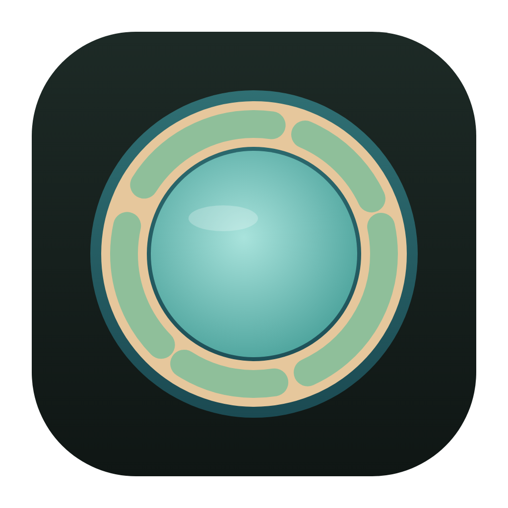
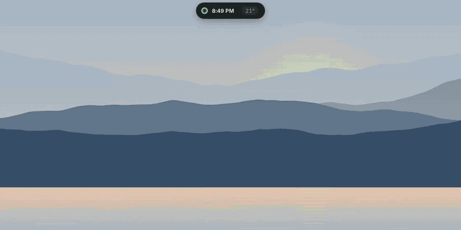
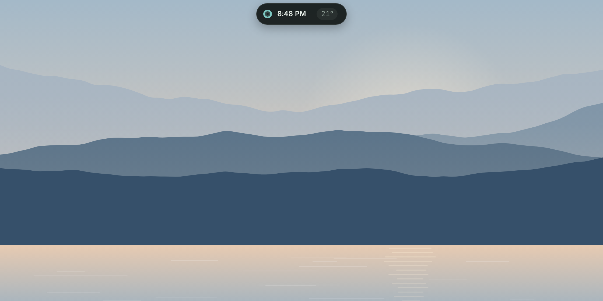
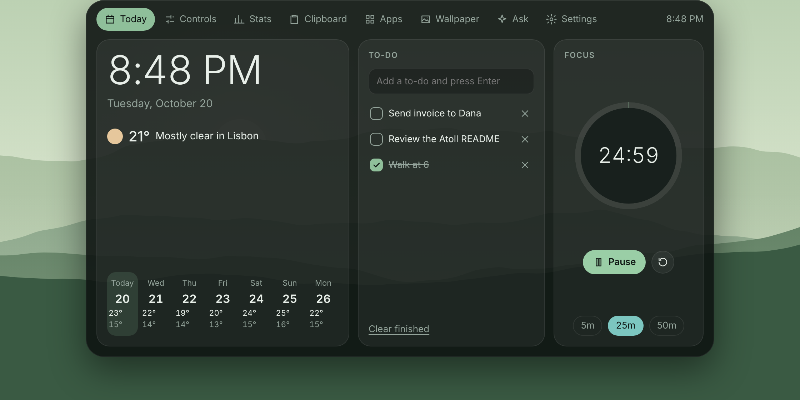
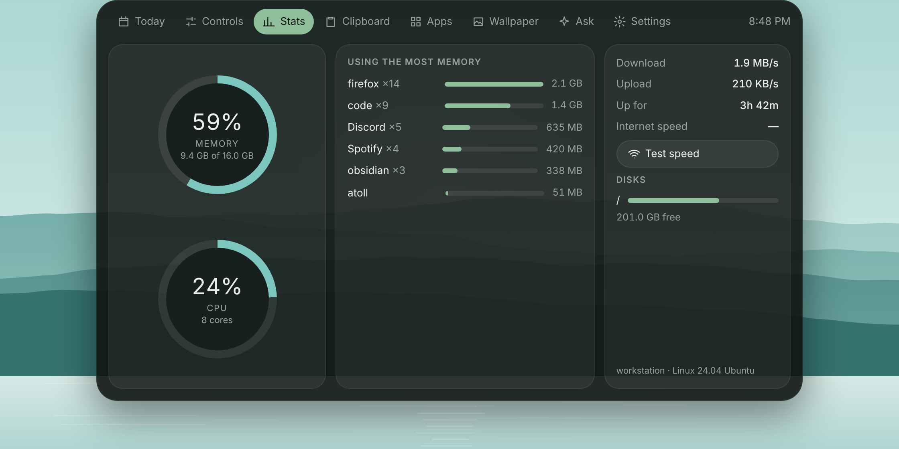
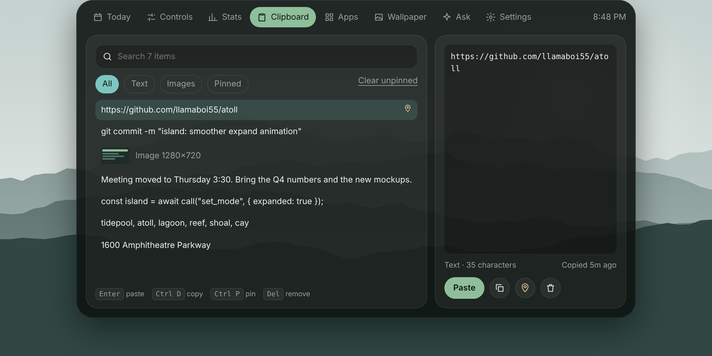
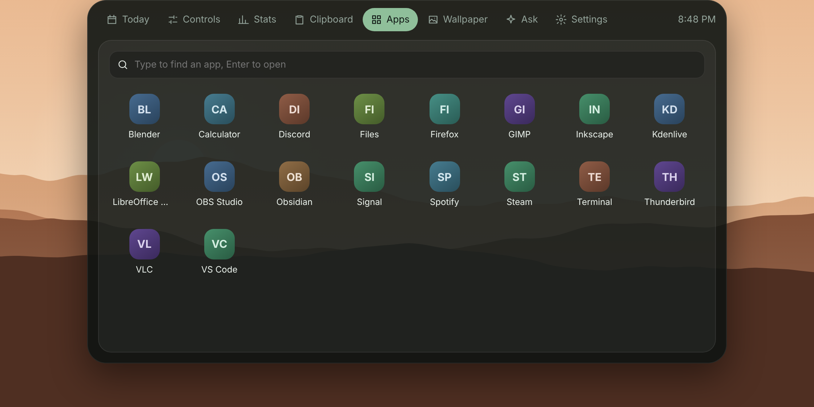
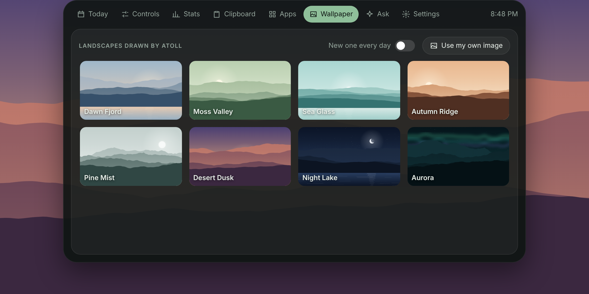
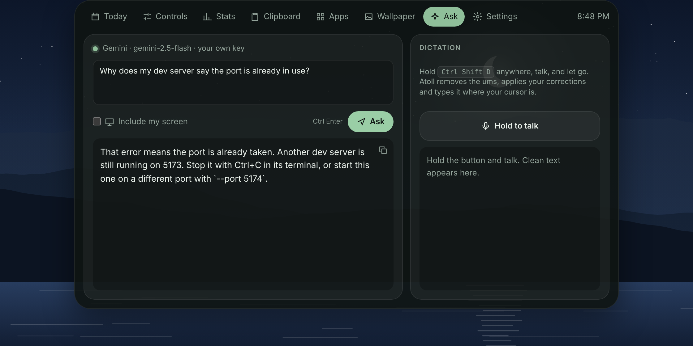
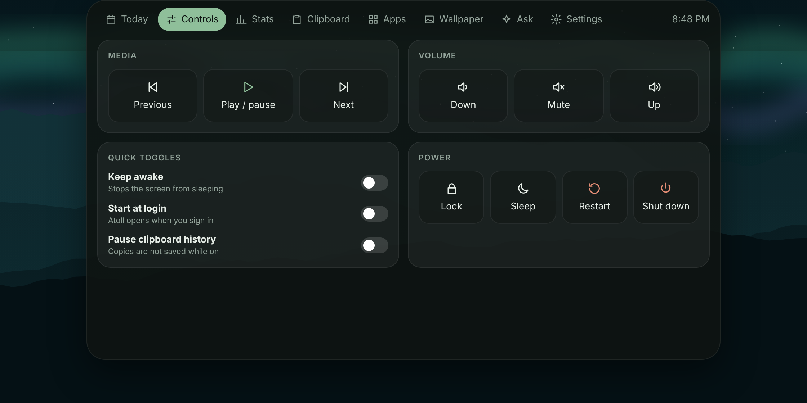

<div align="center">



# Atoll

**A calm island at the top of your screen, on Windows, macOS and Linux.**
It has a clock, weather, to-dos, a focus timer, clipboard history, system stats, an app launcher, media and power controls, and wallpapers.
AI is optional and uses your own free Gemini key or a local Ollama model.
Free and open source. No account, no ads, no paywall.



[Demo video (MP4)](docs/demo.mp4) · [Install](#install) · [Features](#features) · [Compared to paid islands](#compared-to-paid-desktop-islands) · [Privacy](#privacy)

</div>

---

## Install

**Download:** grab the installer for your system from [Releases](https://github.com/llamaboi55/atoll/releases):

| System | File |
|---|---|
| Windows 10/11 | `Atoll_x.y.z_x64-setup.exe` (or the `.msi`) |
| macOS 11+ (Apple silicon and Intel) | `Atoll_x.y.z_universal.dmg` |
| Linux | `.AppImage` (any distro), `.deb` (Debian, Ubuntu) or `.rpm` (Fedora, openSUSE) |

The builds aren't code-signed yet, because signing certificates cost money and Atoll is free. Here's what to do the first time you open it:
- **Windows:** if SmartScreen appears, click *More info*, then *Run anyway*.
- **macOS:** right-click Atoll in Applications, choose *Open*, then confirm. macOS may ask once for Accessibility (needed for media keys and paste) and Screen Recording (only if you use "Include my screen").
- **Linux:** run `chmod +x Atoll*.AppImage` first. On Wayland, global shortcuts depend on your desktop. GNOME and KDE let you bind them in system settings to `atoll`, which opens or closes the island.

**Build it yourself in one command** (needs [Rust](https://rustup.rs) and Node.js 18+, plus the [Tauri system packages](https://v2.tauri.app/start/prerequisites/) on Linux):

```sh
git clone https://github.com/llamaboi55/atoll && cd atoll && npm install && npm run build
```

Installers land in `src-tauri/target/release/bundle/`. Use `npm run dev` to run it with live reload, or `npm run preview` to see the interface in a browser with sample data and no Rust build.

## Features

A small pill sits at the top center of your screen, showing the time, the temperature and any running timer. Click it, scroll on it, or press **Ctrl Shift Space** (**Cmd Shift Space** on a Mac) to open the panel. **Esc**, or clicking anywhere else, tucks it away again. **Ctrl 1** to **Ctrl 8** switch tabs.

| Tab | What it does |
|---|---|
| **Today** | Big clock and date, current weather and a 7-day strip (Open-Meteo, no key), to-dos, and a focus timer with 5, 25 and 50 minute presets. The countdown stays visible in the pill. |
| **Controls** | Play/pause, next, previous, volume and mute. Toggles for keep awake, start at login, and pausing clipboard history. Lock, sleep, restart and shut down, where restart and shut down need a second click. |
| **Stats** | Memory and CPU rings, the apps using the most memory (helpers grouped, like "firefox ×14"), download and upload speed, uptime, disk space, and a one-click internet speed test. |
| **Clipboard** | Searchable history of text and images, with All/Text/Images/Pinned filters and a preview pane. **Enter** pastes into the app you were using, **Ctrl D** copies, **Ctrl P** pins and **Del** removes. Pinned items are never trimmed. |
| **Apps** | Type a few letters and press Enter to launch. Finds Start Menu apps on Windows, `.app` bundles on macOS, and `.desktop` entries on Linux (including Flatpak and Snap). Apps you use most move to the front. |
| **Wallpaper** | Eight original landscapes drawn by Atoll at your screen's exact resolution, an optional new one every day, or any image of your own. |
| **Ask** | Ask a question and optionally include your screen. **Ctrl Shift A** takes a screenshot of what you're looking at *before* the panel opens, so the answer is about your work, not about Atoll. |
| **Dictation** | Hold **Ctrl Shift D** anywhere, talk, and let go. Atoll removes filler words, applies spoken corrections ("Tuesday, no, Thursday") and types the clean text where your cursor is. Needs the Gemini option. |
| **Settings** | AI provider, shortcuts (any key combination), clipboard size, weather city, °C or °F, and 12- or 24-hour time. |

Atoll is built with [Tauri 2](https://tauri.app): a Rust core with your system's own webview, so it doesn't ship a whole browser.

<details>
<summary><b>Screenshots</b></summary>

The screenshots use sample data from the browser preview.

| | |
|---|---|
|  |  |
|  |  |
|  |  |
|  |  |

</details>

## AI setup (optional)

AI is off until you turn it on in **Settings**.

- **Gemini:** create a free API key at [aistudio.google.com](https://aistudio.google.com/apikey) and paste it in. The key is saved in Atoll's config file on your computer (readable only by you on macOS and Linux) and is never sent back to the interface.
- **Ollama (fully offline):** install [Ollama](https://ollama.com), run `ollama pull gemma3`, and choose Ollama in settings. Use a vision model such as `gemma3` or `llava` to ask about your screen. Dictation needs Gemini, because local chat models don't take audio.

## Compared to paid desktop islands

This compares Atoll with Hitodama, the paid Windows island shown in a recent viral Reel. The Hitodama column comes from its public website as of October 2026. Atoll isn't affiliated with Hitodama in any way.

| | **Atoll** | Hitodama |
|---|---|---|
| Price | **Free** | $14 one-time |
| Windows | ✅ | ✅ |
| macOS | ✅ | ❌ |
| Linux | ✅ | ❌ |
| Open source | ✅ MIT | ❌ |
| Works without any AI key | ✅ | ❌ needs your Gemini key |
| Works offline / in countries without the Gemini API | ✅ with Ollama | ❌ |
| Clipboard history with search, pins and images | ✅ | ✅ |
| System stats, top apps and speed test | ✅ | ✅ |
| App launcher | ✅ | ✅ |
| Wallpaper switcher | ✅ original generated art | ✅ |
| Media and power controls | ✅ | ✅ |
| Weather, week view, to-dos, timer | ✅ | ✅ |
| Ask about your screen | ✅ whole screen, typed question | ✅ circle a region, spoken question |
| Dictation that cleans up speech | ✅ | ✅ |
| Routines and scheduled searches | ❌ not yet | ✅ |
| Custom assistant personality | ❌ | ✅ |

## Privacy

- Clipboard history is stored only on your computer, in Atoll's data folder. Pause it at any time, or clear it with one click (pinned items stay).
- Nothing leaves your computer unless you ask a question, dictate, run a speed test (Cloudflare) or show weather (Open-Meteo, with only the city coordinates you picked).
- No telemetry, no analytics and no account.

## Project layout

```
src/                  the interface: plain HTML, CSS and JavaScript modules (no build step)
src/js/tabs/          one file per tab
src/js/scenes.js      generated landscape wallpapers
src-tauri/src/        Rust core
  stats.rs            CPU, memory, top apps, network, disks, speed test
  clipboard.rs        history watcher, storage, pins, thumbnails
  apps.rs             installed-app discovery and launching per OS
  system.rs           media keys, keep awake, power, wallpaper, paste
  ai.rs               Gemini and Ollama, screen capture
  window.rs           pill and panel sizing at the top of the screen
  config.rs           settings file
.github/workflows/    tests on all three systems, and installers on every version tag
```

Run the tests with `npm test`. Issues and ideas are welcome.

## License

[MIT](LICENSE). Use it, change it, share it.

---

<div align="center">

**Atoll is free and always will be.** If it made your desktop a little calmer, you can leave a tip. It's never required, and nothing is locked behind it.


Cash App: **$AtikaKadesha**

</div>
